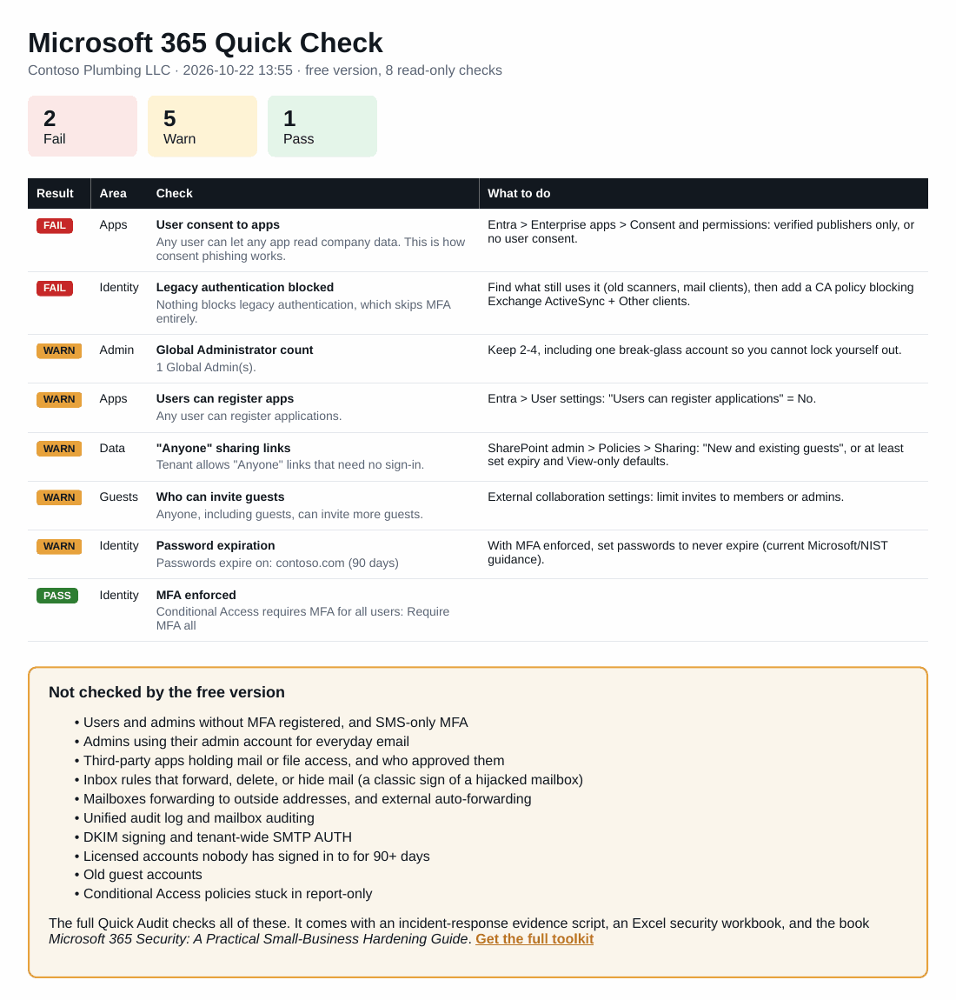

# M365 Quick Check

A free, read-only PowerShell script that checks a small-business Microsoft 365 tenant for the settings attackers abuse most often, then writes a one-page HTML report saying what failed and what to do about it.

It takes about two minutes to run. It changes nothing.

## What it checks

| Check | Why it matters |
|---|---|
| MFA enforced (Security Defaults or Conditional Access) | A stolen password alone shouldn't get anyone in |
| Legacy authentication blocked | IMAP/POP/old SMTP sign-ins skip MFA entirely |
| Global Administrator count | Every extra Global Admin is another account worth phishing |
| User consent to apps | "Sign in with Microsoft" consent phishing doesn't need a password |
| Users can register apps | Attackers love an app they registered from inside your tenant |
| Who can invite guests | Guests inviting guests is how a tenant fills up with strangers |
| Password expiration | Forced expiry pushes people toward weaker passwords once MFA is on |
| "Anyone" sharing links | Files reachable by anyone who gets hold of the link |

Here's the report from a test tenant:



## Run it

From the PowerShell Gallery:

```powershell
Install-Module Microsoft.Graph.Authentication -Scope CurrentUser
Install-Script Invoke-M365QuickCheck -Scope CurrentUser
Invoke-M365QuickCheck.ps1
```

Or download `Invoke-M365QuickCheck.ps1` from this repo and run:

```powershell
Install-Module Microsoft.Graph.Authentication -Scope CurrentUser
.\Invoke-M365QuickCheck.ps1
```

Sign in as a **Global Reader** (best) or Global Administrator. The first time, Microsoft asks you to approve read permissions for "Microsoft Graph Command Line Tools". The report lands in the current folder.

If Windows blocks the downloaded script: `Unblock-File .\Invoke-M365QuickCheck.ps1`

## Permissions it asks for

All read-only: `Policy.Read.All`, `Directory.Read.All`, `RoleManagement.Read.Directory`, `Organization.Read.All`, `SharePointTenantSettings.Read.All`. Read the script before you run it. It's about 260 lines.

## Want more?

This is a cut-down version of the Quick Audit that ships with *Microsoft 365 Security: A Practical Small-Business Hardening Guide*. The full version adds about sixteen more checks, among them MFA registration gaps, SMS-only MFA, admins reading email on admin accounts, risky third-party apps, inbox rules that hide mail, external forwarding, audit logging, DKIM, SMTP AUTH, and stale licensed accounts. It also comes with a script that collects the evidence on a compromised account before anyone starts deleting things.

[Book + Toolkit on Gumroad](https://radio1one.gumroad.com/l/qvoxbr)

## How this was made

Written with AI assistance, then reviewed and tested by me against a live Microsoft 365 tenant. Every Graph call is a GET, and it's short enough to read in one sitting, so please do read it before you run it.

## License

MIT. Use it on your own tenants and your clients' tenants. Issues and pull requests welcome.
